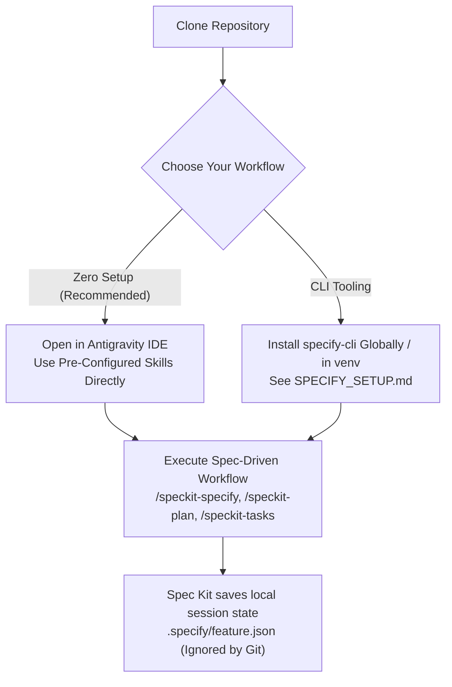
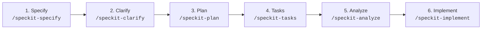

# Spec-Driven Development using Spec Kit & Antigravity

A project template and ready-to-use workspace for practicing **Spec-Driven Development (SDD)** with AI coding agents using GitHub's **Spec Kit** and **Google Antigravity**.

---

## 🚀 How to Use This Repository

You have two paths to work with this project:



---

### Option 1: Direct Use (Zero Setup — Recommended)

**You do not need to install `specify-cli` on your system to use this repository.**

All required Spec Kit configurations and agent skills are already bundled and pre-configured directly inside this repository:
* **`.agents/skills/`**: Pre-installed agent skills configured for Antigravity.
* **`.specify/`**: Templates, workflows, scripts, and integration manifests.

#### Getting Started Immediately:
1. Clone this repository and open the workspace folder in the **Antigravity IDE**.
2. Open the AI chat and run any Spec Kit command (e.g., `/speckit-specify <feature description>`).
3. Antigravity will automatically discover the skills in [`.agents/skills/`](file:///c:/Users/Pathi/Documents/specdriven_sepecit/Specdriven_using_specit/.agents/skills) and execute them.

---

### Option 2: Full Spec Kit CLI Setup & Troubleshooting

If you want to install the `specify-cli` command-line tool globally, initialize fresh projects from scratch, or troubleshoot environment errors (such as `Agent Detection Error: agy not found`):

👉 **Please refer to the detailed [Spec Kit Setup & Troubleshooting Guide](file:///c:/Users/Pathi/Documents/specdriven_sepecit/Specdriven_using_specit/SPECIFY_SETUP.md).**

The guide covers:
- Installing `specify-cli` globally with `uv` / `pipx` or locally via Python `venv`.
- Initializing Spec Kit with `--ignore-agent-tools`.
- Troubleshooting Windows execution policies and missing binary detection errors.

---

## 🗄️ How JSON State & Local Storage Work

When you run Spec Kit workflows in this project:

1. **Dynamic Session Pointer (`.specify/feature.json`)**:
   - Whenever you create or switch to a feature (e.g., `/speckit-specify`), Spec Kit automatically writes a machine-local state file: `.specify/feature.json`.
   - This file acts as **local storage for your active workspace**, recording the path to the current feature directory (such as `specs/001-doctor-appointment-booking/`).
   - Downstream skills (like `/speckit-plan` and `/speckit-tasks`) read this file to know which feature you are actively developing without needing you to specify folder paths repeatedly.

2. **Why State JSON Files Are Ignored by Git**:
   - Machine-local state files (`.specify/feature.json`) are intentionally excluded via [.gitignore](file:///c:/Users/Pathi/Documents/specdriven_sepecit/Specdriven_using_specit/.gitignore) and [.specify/.gitignore](file:///c:/Users/Pathi/Documents/specdriven_sepecit/Specdriven_using_specit/.specify/.gitignore).
   - This prevents active feature pointers from polluting Git history and ensures multiple team members or branches can work on different features concurrently without merge conflicts.

---

## 📁 Repository Structure

```text
├── .agents/
│   └── skills/                  # Spec Kit skills discovered automatically by Antigravity
│       ├── speckit-specify/     # /speckit-specify: Create or update feature specs
│       ├── speckit-clarify/     # /speckit-clarify: Resolve ambiguities & underspecified areas
│       ├── speckit-constitution/# /speckit-constitution: Manage project architectural rules
│       ├── speckit-plan/        # /speckit-plan: Generate architecture, data models, contracts
│       ├── speckit-tasks/       # /speckit-tasks: Generate dependency-ordered actionable tasks
│       ├── speckit-analyze/     # /speckit-analyze: Verify consistency across artifacts
│       ├── speckit-implement/   # /speckit-implement: Execute tasks and write code
│       ├── speckit-checklist/   # /speckit-checklist: Create verification checklists
│       └── speckit-converge/    # /speckit-converge: Verify code convergence against specs
├── .specify/                    # Spec Kit configuration, templates, scripts, workflows
│   ├── memory/                  # Constitution and project principles
│   ├── scripts/powershell/      # PowerShell helper scripts used by skills
│   ├── templates/               # Markdown templates (spec, plan, tasks, checklist)
│   └── workflows/               # Specification automation workflows
├── specs/                       # Generated feature specs, plans, and task breakdowns
├── .gitignore                   # Excludes virtual environments & local feature state (.specify/feature.json)
├── README.md                    # Main project overview and workflow documentation
├── SPECIFY_SETUP.md             # Complete specify-cli installation & troubleshooting guide
└── requirements.txt             # Project Python dependencies
```

---

## 🔄 Spec-Driven Development Workflow

The recommended development cycle follows a clean, structured flow:



1. **Specify (`/speckit-specify <description>`)**:
   - Transforms natural language requirements into a structured specification in `specs/<feature-id>/spec.md`.
   - Records the active feature in `.specify/feature.json`.

2. **Clarify (`/speckit-clarify`)**:
   - Analyzes the specification to identify underspecified areas, asks targeted clarifying questions, and incorporates answers back into `spec.md`.

3. **Plan (`/speckit-plan`)**:
   - Synthesizes the architecture, API contracts, data models, and research in `plan.md`.

4. **Tasks (`/speckit-tasks`)**:
   - Generates an actionable, ordered list of tasks in `tasks.md` grouped by phase and user story.

5. **Analyze (`/speckit-analyze`)**:
   - Runs a non-destructive cross-artifact consistency check ensuring `tasks.md`, `plan.md`, and `spec.md` are aligned.

6. **Implement (`/speckit-implement`)**:
   - Executes tasks systematically, writing source code, adding tests, and validating functionality.
