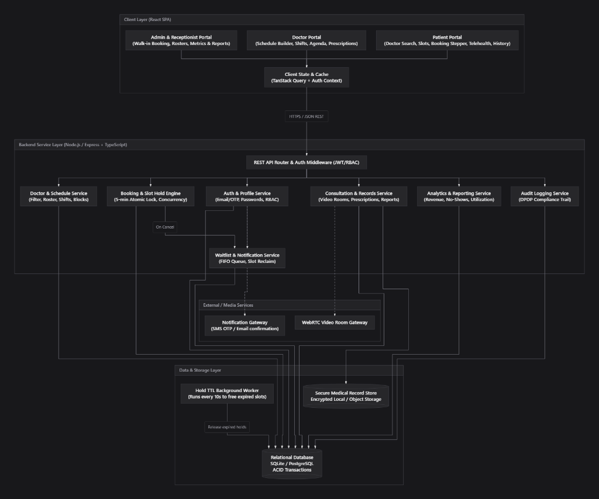
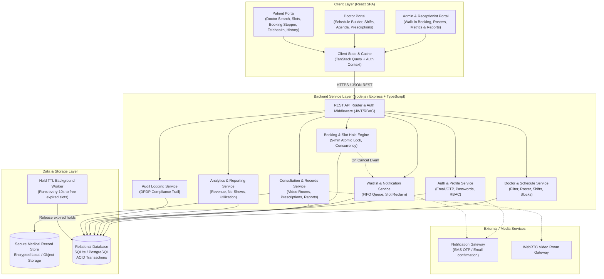
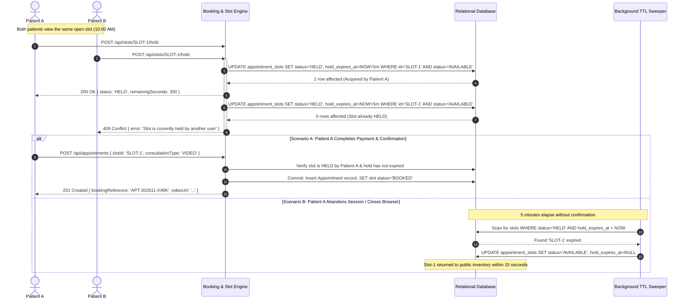
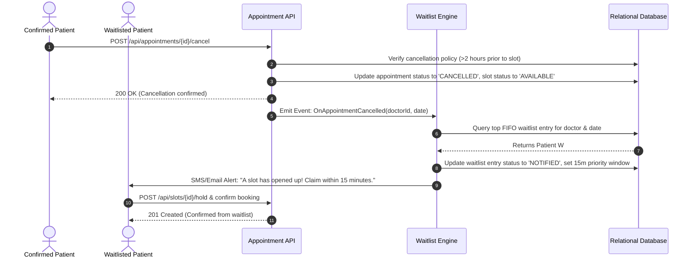

# System Architecture Overview: Doctor Appointment Booking System

This document provides a comprehensive technical breakdown of the **Doctor Appointment Booking System**, detailing its architectural layers, component responsibilities, data flows, concurrency guarantees, and security model.

---

## 1. System Architecture Diagram

### Interactive Architecture Diagram (Mermaid)

---

## 2. Layer-by-Layer Architectural Breakdown

The system is organized into four distinct architectural layers, ensuring loose coupling, separation of concerns, and clear maintenance boundaries.

### Layer 1: Client Layer (React Single Page Application)

The frontend is built as a single-page application using **React 18+**, **TypeScript**, **Vite**, and **Tailwind CSS**. It provides customized, responsive user journeys for three primary user personas:

1. **Patient Portal**:
   - **Search & Discovery**: Multi-facet search filtering doctors by medical specialization, geographical location (city/clinic), consultation fee range, spoken languages, and real-time slot availability.
   - **Provider Profiles**: Displays verified credentials, experience, clinic affiliations, patient ratings, and an interactive slot calendar.
   - **Booking Stepper & Live Hold Timer**: Guides patients through slot selection, triggers the 5-minute atomic hold lock with a live countdown timer, captures patient health notes, and handles checkout.
   - **Telehealth & Medical History**: Provides access to browser-native video consultation rooms, past appointment history, digital prescriptions, and diagnostic lab report uploads.
   - **Feedback & Reviews**: Enables 1 to 5-star ratings and written reviews following completed appointments.

2. **Doctor Portal**:
   - **Schedule Builder**: Allows doctors to set weekly recurring shifts, consultation slot durations (15, 30, 45, or 60 minutes), and lunch/clinical break intervals.
   - **Leave & Emergency Blocks**: Allows doctors to block out specific dates or time windows for planned leave or emergency unavailability, with automated conflict detection for existing bookings.
   - **Consultation Agenda**: Displays daily and weekly patient consultation queues with one-click access to patient history and video consultation rooms.
   - **Digital Prescriptions**: Enables doctors to issue clinical visit notes and prescriptions directly to patient profiles upon consultation completion.

3. **Admin & Receptionist Portal**:
   - **Walk-in & Phone-in Booking**: Allows clinic receptionists to schedule, reschedule, or cancel appointments on behalf of walk-in patients, with "Pay at Clinic" tracking.
   - **Roster & Doctor Management**: Onboards new doctors, approves clinic affiliations, and updates operational hours.
   - **Operational Analytics & Reporting**: Interactive dashboards displaying booking volumes, revenue summaries, cancellation percentages, no-show rates, and doctor utilization metrics.

4. **Client State & Cache**:
   - Powered by **TanStack Query (React Query)** for efficient server-state caching, automatic slot availability background polling, and optimistic UI transitions.
   - React **Auth Context** persists JWT access tokens and role claims across protected routes.

---

### Layer 2: Backend Service Layer (Node.js / Express + TypeScript)

The backend provides a modular RESTful API built on **Node.js 22** and **Express**, adhering to strict domain-driven service separation:

| Service | Primary Responsibility |
|---------|------------------------|
| **REST API Router & Auth Middleware** | Central gateway validating incoming HTTP requests via **Zod**, verifying JWT bearer tokens, and enforcing Role-Based Access Control (RBAC). |
| **Auth & Profile Service** | Handles user registration, salted password hashing (Bcrypt/Argon2), SMS/Email OTP verification, password recovery, and patient profile management. |
| **Doctor & Schedule Service** | Indexes doctor profiles, calculates public calendar availability, generates recurring appointment slots, and applies schedule blocks. |
| **Booking & Slot Hold Engine** | Orchestrates appointment creation, enforces the 5-minute atomic reservation hold, and guarantees zero double-booking under high concurrency. |
| **Waitlist & Notification Service** | Manages FIFO waitlists for fully booked dates; automatically alerts waitlisted patients when a slot opens up due to cancellation. |
| **Consultation & Records Service** | Generates secure tokenized room URLs for video visits and manages encrypted storage for patient lab reports and digital prescriptions. |
| **Analytics & Reporting Service** | Computes operational metrics (revenue, no-show rates, cancellation rates, doctor utilization) across clinics and date ranges. |
| **Audit Logging Service** | Captures an immutable trail of security events, appointment status changes, and medical record accesses for compliance with health privacy regulations (DPDP Act). |

---

### Layer 3: External & Media Services

- **Notification Gateway**: Integrates with SMS and Email delivery APIs to dispatch OTP codes, instant booking confirmations, cancellation receipts, and priority waitlist alerts.
- **WebRTC Video Room Gateway**: Generates cryptographically signed, peer-to-peer or tokenized video consultation room URLs, enabling browser-native telehealth visits without requiring any external app downloads.

---

### Layer 4: Data & Storage Layer

- **Relational Database (SQLite / PostgreSQL)**:
  - Maintains strict ACID transaction semantics for booking operations.
  - Relational schema enforcing foreign keys, check constraints, unique slot constraints, and indexing for fast calendar range queries.
  - Portable architecture: zero-config SQLite (`better-sqlite3`) for development and local testing, easily migrating to PostgreSQL for large-scale production deployments.
- **Secure Medical Record Store**:
  - File storage abstraction for diagnostic lab reports, medical scans, and prescription PDFs.
  - Protected by short-lived, signed access tokens (expiring in 10 minutes) accessible exclusively by the authenticated patient and their authorized treating doctor.
- **Hold TTL Background Worker**:
  - A lightweight asynchronous worker running every 10 seconds.
  - Scans for slots in `HELD` status where `hold_expires_at < CURRENT_TIMESTAMP` and resets them to `AVAILABLE`, ensuring abandoned slots are restored to the public pool within 15 seconds.

---

## 3. Core Concurrency Mechanism: 5-Minute Atomic Slot Hold

To satisfy the non-functional requirement of supporting **1,000+ concurrent active users** while guaranteeing **zero double-booking**, the system employs atomic database state-machine locking rather than fragile client-side checks:

---

## 4. Cancellation & Automated Waitlist Cascade

When a confirmed appointment is cancelled, the system automatically triggers a notification cascade to fill the vacated slot:

---

## 5. Security, RBAC & Data Privacy Governance

1. **Role-Based Access Control (RBAC)**:
   - Users are strictly segmented into `PATIENT`, `DOCTOR`, `RECEPTIONIST`, and `ADMIN`.
   - Access to endpoints and mutations is verified via middleware against claims encoded in tamper-proof JWT tokens.
2. **Health Data Privacy (India's DPDP Act & Health Norms)**:
   - **Audit Logs**: All sensitive operations (appointment status changes, record uploads, clinical note edits, and admin overrides) are recorded in an append-only `audit_logs` table containing actor ID, IP address, timestamp, and action context.
   - **Encryption**: Passwords and OTP hashes are secured using industry-standard hashing algorithms (Bcrypt/Argon2). Data in transit is protected via HTTPS/TLS 1.3.
   - **Restricted Clinical Access**: Medical records and consultation notes are strictly accessible only to the patient and the specific treating physician assigned to that appointment.

---

## 6. Specification & Design References

The detailed specification artifacts generated via **Spec Kit** can be reviewed in:
- [Feature Specification (`spec.md`)](file:///c:/Users/Pathi/Documents/specdriven_sepecit/Specdriven_using_specit/specs/001-doctor-appointment-booking/spec.md)
- [Implementation Plan (`plan.md`)](file:///c:/Users/Pathi/Documents/specdriven_sepecit/Specdriven_using_specit/specs/001-doctor-appointment-booking/plan.md)
- [Technical Research & Decisions (`research.md`)](file:///c:/Users/Pathi/Documents/specdriven_sepecit/Specdriven_using_specit/specs/001-doctor-appointment-booking/research.md)
- [Data Model & State Machines (`data-model.md`)](file:///c:/Users/Pathi/Documents/specdriven_sepecit/Specdriven_using_specit/specs/001-doctor-appointment-booking/data-model.md)
- [OpenAPI 3.0 API Contract (`contracts/api-spec.yaml`)](file:///c:/Users/Pathi/Documents/specdriven_sepecit/Specdriven_using_specit/specs/001-doctor-appointment-booking/contracts/api-spec.yaml)
- [Validation & Quickstart Guide (`quickstart.md`)](file:///c:/Users/Pathi/Documents/specdriven_sepecit/Specdriven_using_specit/specs/001-doctor-appointment-booking/quickstart.md)

