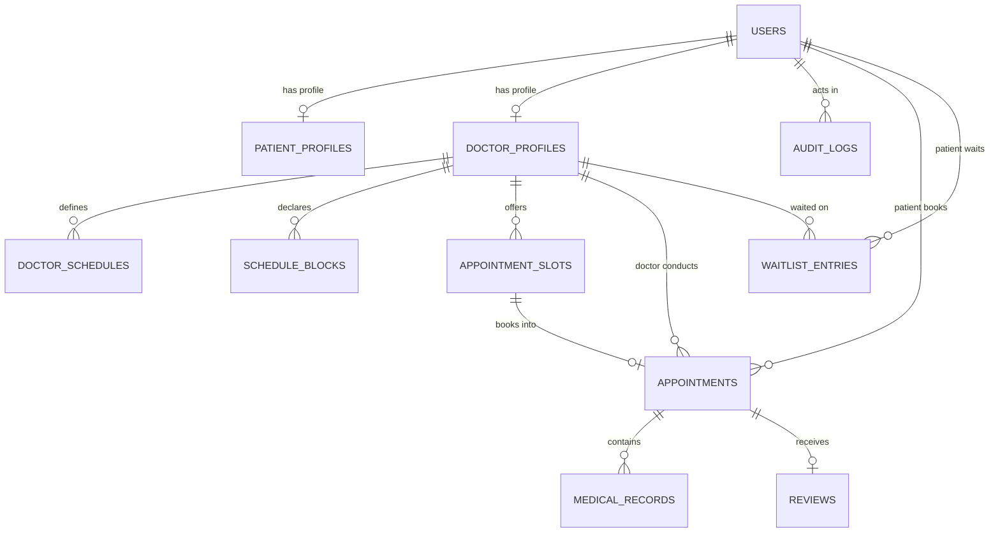
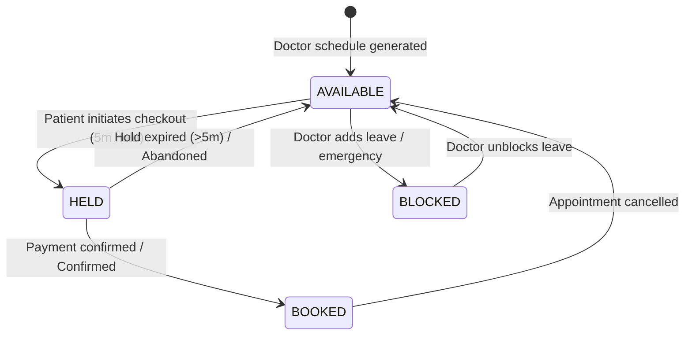
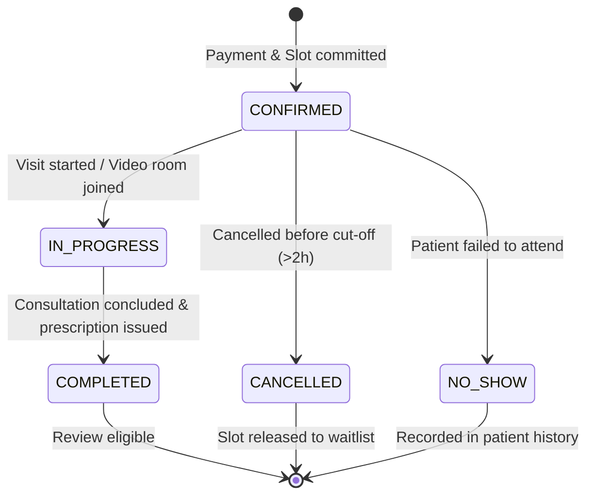

# Data Model Specification: Doctor Appointment Booking System

**Feature**: `001-doctor-appointment-booking`  
**Date**: 2026-11-17  
**Status**: Completed  

---

## 1. Entity-Relationship Overview

---

## 2. Entity Schemas

### 2.1 `users`
Represents all system users with credentials and assigned authorization role.

| Column | Type | Constraints | Description |
|--------|------|-------------|-------------|
| `id` | VARCHAR(36) | PRIMARY KEY | UUIDv4 identifier |
| `role` | VARCHAR(20) | NOT NULL, CHECK in (`'PATIENT'`, `'DOCTOR'`, `'ADMIN'`, `'RECEPTIONIST'`) | RBAC role |
| `name` | VARCHAR(120) | NOT NULL | Full name of the user |
| `email` | VARCHAR(160) | UNIQUE, NULLABLE | User email address |
| `phone` | VARCHAR(20) | UNIQUE, NULLABLE | Mobile phone number |
| `password_hash` | VARCHAR(255) | NULLABLE | Salted hash (Argon2id/Bcrypt) |
| `otp_secret` | VARCHAR(64) | NULLABLE | Temporary hash for OTP verification |
| `otp_expires_at` | TIMESTAMP | NULLABLE | Expiration time of active OTP |
| `status` | VARCHAR(20) | NOT NULL, DEFAULT `'ACTIVE'`, CHECK in (`'ACTIVE'`, `'SUSPENDED'`, `'INACTIVE'`) | Account status |
| `created_at` | TIMESTAMP | NOT NULL, DEFAULT CURRENT_TIMESTAMP | UTC creation timestamp |
| `updated_at` | TIMESTAMP | NOT NULL, DEFAULT CURRENT_TIMESTAMP | UTC modification timestamp |

---

### 2.2 `patient_profiles`
Holds healthcare-relevant demographic and personal health details.

| Column | Type | Constraints | Description |
|--------|------|-------------|-------------|
| `id` | VARCHAR(36) | PRIMARY KEY | UUIDv4 |
| `user_id` | VARCHAR(36) | UNIQUE, FOREIGN KEY (`users.id`) ON DELETE CASCADE | Associated user account |
| `dob` | DATE | NULLABLE | Date of birth |
| `gender` | VARCHAR(20) | NULLABLE | Gender identity (`'MALE'`, `'FEMALE'`, `'OTHER'`) |
| `blood_group` | VARCHAR(10) | NULLABLE | e.g. `'O+'`, `'A+'`, `'B-'`, etc. |
| `emergency_contact_name` | VARCHAR(100) | NULLABLE | Emergency contact person name |
| `emergency_contact_phone` | VARCHAR(20) | NULLABLE | Emergency contact phone number |
| `allergies` | TEXT | NULLABLE | Known allergies notes |
| `medical_history_summary` | TEXT | NULLABLE | Baseline chronic illnesses or surgical history |
| `no_show_count` | INTEGER | NOT NULL, DEFAULT 0 | Count of unexcused missed appointments |
| `created_at` | TIMESTAMP | NOT NULL, DEFAULT CURRENT_TIMESTAMP | UTC timestamp |
| `updated_at` | TIMESTAMP | NOT NULL, DEFAULT CURRENT_TIMESTAMP | UTC timestamp |

---

### 2.3 `doctor_profiles`
Holds professional qualifications, consultation settings, and rating aggregates.

| Column | Type | Constraints | Description |
|--------|------|-------------|-------------|
| `id` | VARCHAR(36) | PRIMARY KEY | UUIDv4 |
| `user_id` | VARCHAR(36) | UNIQUE, FOREIGN KEY (`users.id`) ON DELETE CASCADE | Associated user account |
| `specialization` | VARCHAR(100) | NOT NULL | e.g. `'Cardiology'`, `'Pediatrics'`, etc. |
| `qualifications` | VARCHAR(200) | NOT NULL | e.g. `'MBBS, MD (Cardiology)'` |
| `experience_years` | INTEGER | NOT NULL, DEFAULT 0 | Years in active practice |
| `languages` | TEXT | NOT NULL | JSON string array of spoken languages |
| `bio` | TEXT | NULLABLE | Biography and clinical background |
| `clinic_name` | VARCHAR(160) | NOT NULL | Associated clinic or hospital facility |
| `clinic_address` | TEXT | NOT NULL | Full physical clinic address |
| `city` | VARCHAR(80) | NOT NULL | Location city for geo search |
| `in_person_fee` | DECIMAL(10,2) | NOT NULL | Fee in local currency (e.g., INR) |
| `video_fee` | DECIMAL(10,2) | NOT NULL | Video consultation fee |
| `rating_avg` | DECIMAL(3,2) | NOT NULL, DEFAULT 0.00 | Average rating (1.00 to 5.00) |
| `rating_count` | INTEGER | NOT NULL, DEFAULT 0 | Total number of verified reviews |
| `created_at` | TIMESTAMP | NOT NULL, DEFAULT CURRENT_TIMESTAMP | UTC timestamp |
| `updated_at` | TIMESTAMP | NOT NULL, DEFAULT CURRENT_TIMESTAMP | UTC timestamp |

---

### 2.4 `doctor_schedules`
Defines recurring weekly working shifts and slot durations.

| Column | Type | Constraints | Description |
|--------|------|-------------|-------------|
| `id` | VARCHAR(36) | PRIMARY KEY | UUIDv4 |
| `doctor_id` | VARCHAR(36) | FOREIGN KEY (`doctor_profiles.id`) ON DELETE CASCADE | Target doctor |
| `day_of_week` | INTEGER | NOT NULL, CHECK between 0 (Sun) and 6 (Sat) | Day of week |
| `shift_start_time` | TIME | NOT NULL | Start of working shift (e.g., `'09:00'`) |
| `shift_end_time` | TIME | NOT NULL | End of working shift (e.g., `'17:00'`) |
| `break_start_time` | TIME | NULLABLE | Start of lunch or clinical break |
| `break_end_time` | TIME | NULLABLE | End of lunch or clinical break |
| `slot_duration_minutes` | INTEGER | NOT NULL, DEFAULT 30, CHECK in (15, 30, 45, 60) | Slot interval |
| `is_active` | BOOLEAN | NOT NULL, DEFAULT TRUE | Active status |

---

### 2.5 `schedule_blocks`
Ad-hoc leaves, emergency unavailable windows, and clinic closures.

| Column | Type | Constraints | Description |
|--------|------|-------------|-------------|
| `id` | VARCHAR(36) | PRIMARY KEY | UUIDv4 |
| `doctor_id` | VARCHAR(36) | FOREIGN KEY (`doctor_profiles.id`) ON DELETE CASCADE | Doctor affected |
| `start_time` | TIMESTAMP | NOT NULL | Start date & time in UTC |
| `end_time` | TIMESTAMP | NOT NULL | End date & time in UTC |
| `reason` | VARCHAR(255) | NOT NULL | Reason (e.g., `'Annual Leave'`, `'Emergency'`) |
| `is_emergency` | BOOLEAN | NOT NULL, DEFAULT FALSE | Flags emergency status requiring patient alerts |
| `created_at` | TIMESTAMP | NOT NULL, DEFAULT CURRENT_TIMESTAMP | UTC timestamp |

---

### 2.6 `appointment_slots`
Discreet time slots representing the inventory of bookable segments.

| Column | Type | Constraints | Description |
|--------|------|-------------|-------------|
| `id` | VARCHAR(36) | PRIMARY KEY | UUIDv4 |
| `doctor_id` | VARCHAR(36) | FOREIGN KEY (`doctor_profiles.id`) ON DELETE CASCADE | Doctor offering slot |
| `start_time` | TIMESTAMP | NOT NULL | Slot start in UTC |
| `end_time` | TIMESTAMP | NOT NULL | Slot end in UTC |
| `status` | VARCHAR(20) | NOT NULL, DEFAULT `'AVAILABLE'`, CHECK in (`'AVAILABLE'`, `'HELD'`, `'BOOKED'`, `'BLOCKED'`) | Slot status |
| `held_by_user_id` | VARCHAR(36) | NULLABLE, FOREIGN KEY (`users.id`) | Patient holding slot during checkout |
| `hold_expires_at` | TIMESTAMP | NULLABLE | 5-minute hold timestamp deadline |
| `created_at` | TIMESTAMP | NOT NULL, DEFAULT CURRENT_TIMESTAMP | UTC timestamp |

**Indexes & Constraints**:
- `UNIQUE(doctor_id, start_time)` (guarantees a doctor cannot have duplicate overlapping slot records).
- `INDEX(doctor_id, start_time, status)` for fast calendar range queries.

---

### 2.7 `appointments`
The central booking record linking patient, doctor, slot, and consultation status.

| Column | Type | Constraints | Description |
|--------|------|-------------|-------------|
| `id` | VARCHAR(36) | PRIMARY KEY | UUIDv4 |
| `booking_reference` | VARCHAR(16) | NOT NULL, UNIQUE | Alphanumeric confirmation code (e.g. `'APT-202611-X49K'`) |
| `patient_id` | VARCHAR(36) | NOT NULL, FOREIGN KEY (`users.id`) | Patient who booked |
| `doctor_id` | VARCHAR(36) | NOT NULL, FOREIGN KEY (`doctor_profiles.id`) | Doctor conducting visit |
| `slot_id` | VARCHAR(36) | NOT NULL, UNIQUE, FOREIGN KEY (`appointment_slots.id`) | Bound slot |
| `consultation_type` | VARCHAR(20) | NOT NULL, CHECK in (`'IN_PERSON'`, `'VIDEO'`) | Mode of visit |
| `status` | VARCHAR(20) | NOT NULL, DEFAULT `'CONFIRMED'`, CHECK in (`'CONFIRMED'`, `'IN_PROGRESS'`, `'COMPLETED'`, `'CANCELLED'`, `'NO_SHOW'`) | Lifecycle status |
| `fee_amount` | DECIMAL(10,2) | NOT NULL | Total consultation fee charged |
| `payment_status` | VARCHAR(20) | NOT NULL, CHECK in (`'PAID'`, `'PENDING'`, `'AT_CLINIC'`, `'REFUNDED'`) | Payment state |
| `payment_reference` | VARCHAR(100) | NULLABLE | Transaction ID or receipt number |
| `video_room_id` | VARCHAR(64) | NULLABLE | Secure tokenized room identifier for video |
| `cancellation_reason` | TEXT | NULLABLE | Reason provided on cancellation |
| `cancelled_at` | TIMESTAMP | NULLABLE | Timestamp of cancellation |
| `cancelled_by_user_id` | VARCHAR(36) | NULLABLE, FOREIGN KEY (`users.id`) | User initiating cancellation |
| `created_at` | TIMESTAMP | NOT NULL, DEFAULT CURRENT_TIMESTAMP | UTC timestamp |
| `updated_at` | TIMESTAMP | NOT NULL, DEFAULT CURRENT_TIMESTAMP | UTC timestamp |

---

### 2.8 `waitlist_entries`
FIFO waitlist for dates where a doctor's calendar is fully booked.

| Column | Type | Constraints | Description |
|--------|------|-------------|-------------|
| `id` | VARCHAR(36) | PRIMARY KEY | UUIDv4 |
| `doctor_id` | VARCHAR(36) | NOT NULL, FOREIGN KEY (`doctor_profiles.id`) | Desired doctor |
| `patient_id` | VARCHAR(36) | NOT NULL, FOREIGN KEY (`users.id`) | Waiting patient |
| `target_date` | DATE | NOT NULL | Date requested |
| `consultation_type` | VARCHAR(20) | NOT NULL, CHECK in (`'IN_PERSON'`, `'VIDEO'`) | Mode requested |
| `status` | VARCHAR(20) | NOT NULL, DEFAULT `'ACTIVE'`, CHECK in (`'ACTIVE'`, `'NOTIFIED'`, `'CLAIMED'`, `'EXPIRED'`) | Waitlist status |
| `notified_at` | TIMESTAMP | NULLABLE | When priority slot notification was dispatched |
| `notification_expires_at` | TIMESTAMP | NULLABLE | Priority reservation window deadline (15m) |
| `created_at` | TIMESTAMP | NOT NULL, DEFAULT CURRENT_TIMESTAMP | UTC timestamp |

---

### 2.9 `medical_records`
Clinical documents, test reports, and digital prescriptions.

| Column | Type | Constraints | Description |
|--------|------|-------------|-------------|
| `id` | VARCHAR(36) | PRIMARY KEY | UUIDv4 |
| `appointment_id` | VARCHAR(36) | NULLABLE, FOREIGN KEY (`appointments.id`) | Related visit |
| `patient_id` | VARCHAR(36) | NOT NULL, FOREIGN KEY (`users.id`) | Patient owner |
| `uploaded_by_user_id` | VARCHAR(36) | NOT NULL, FOREIGN KEY (`users.id`) | Author or uploader |
| `record_type` | VARCHAR(30) | NOT NULL, CHECK in (`'PRESCRIPTION'`, `'LAB_REPORT'`, `'DIAGNOSTIC_IMAGE'`, `'VISIT_SUMMARY'`, `'OTHER'`) | Document type |
| `file_name` | VARCHAR(255) | NOT NULL | Original filename |
| `file_mime_type` | VARCHAR(80) | NOT NULL | e.g. `'application/pdf'`, `'image/jpeg'` |
| `file_size_bytes` | BIGINT | NOT NULL | Size in bytes |
| `file_storage_key` | VARCHAR(255) | NOT NULL | Internal secure storage path/URI |
| `notes` | TEXT | NULLABLE | Summary notes or prescription instructions |
| `created_at` | TIMESTAMP | NOT NULL, DEFAULT CURRENT_TIMESTAMP | UTC timestamp |

---

### 2.10 `reviews`
Patient feedback collected following completed consultations.

| Column | Type | Constraints | Description |
|--------|------|-------------|-------------|
| `id` | VARCHAR(36) | PRIMARY KEY | UUIDv4 |
| `appointment_id` | VARCHAR(36) | NOT NULL, UNIQUE, FOREIGN KEY (`appointments.id`) | Exactly 1 review per visit |
| `doctor_id` | VARCHAR(36) | NOT NULL, FOREIGN KEY (`doctor_profiles.id`) | Doctor reviewed |
| `patient_id` | VARCHAR(36) | NOT NULL, FOREIGN KEY (`users.id`) | Patient author |
| `rating` | INTEGER | NOT NULL, CHECK between 1 and 5 | Star score |
| `comment` | TEXT | NULLABLE | Qualitative patient review |
| `created_at` | TIMESTAMP | NOT NULL, DEFAULT CURRENT_TIMESTAMP | UTC timestamp |

---

### 2.11 `audit_logs`
Immutable compliance and security trail for DPDP compliance.

| Column | Type | Constraints | Description |
|--------|------|-------------|-------------|
| `id` | VARCHAR(36) | PRIMARY KEY | UUIDv4 |
| `actor_user_id` | VARCHAR(36) | NULLABLE, FOREIGN KEY (`users.id`) | User who performed action |
| `action` | VARCHAR(60) | NOT NULL | e.g. `'HOLD_SLOT'`, `'BOOK_APPOINTMENT'`, `'CANCEL_APPOINTMENT'`, `'VIEW_RECORD'` |
| `resource_type` | VARCHAR(40) | NOT NULL | e.g. `'APPOINTMENT'`, `'SLOT'`, `'MEDICAL_RECORD'` |
| `resource_id` | VARCHAR(36) | NOT NULL | Identifier of affected record |
| `ip_address` | VARCHAR(45) | NULLABLE | Client IP |
| `details` | TEXT | NULLABLE | JSON payload with context |
| `created_at` | TIMESTAMP | NOT NULL, DEFAULT CURRENT_TIMESTAMP | UTC timestamp |

---

## 3. State Machines

### 3.1 Slot Lifecycle State Machine

### 3.2 Appointment Lifecycle State Machine

