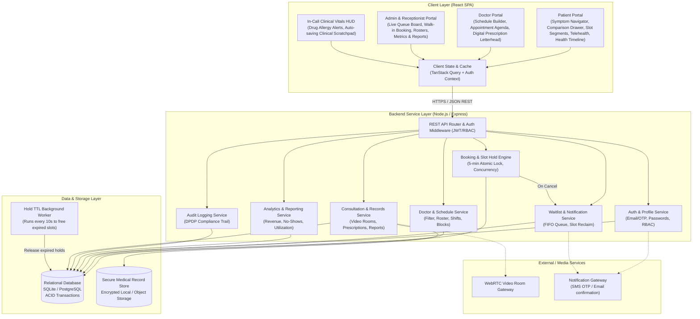
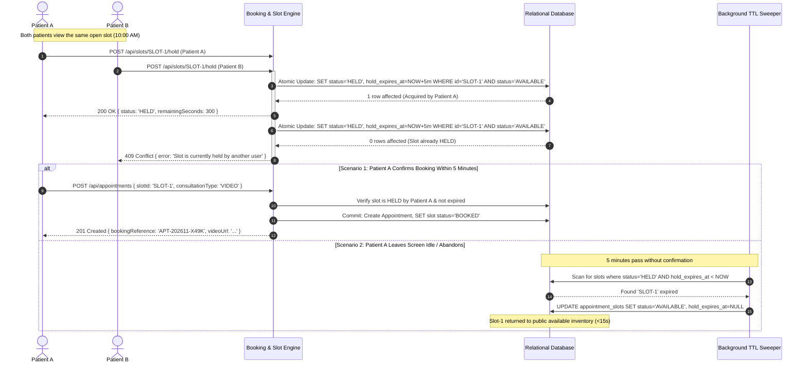
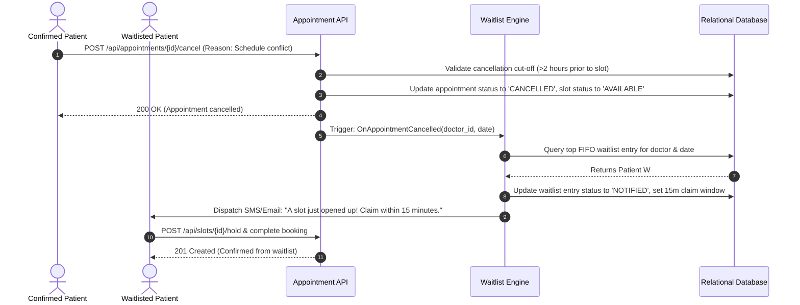

# Implementation Plan: Doctor Appointment Booking System

**Branch**: `001-doctor-appointment-booking` | **Date**: 2026-11-17 | **Spec**: [spec.md](file:///c:/Users/Pathi/Documents/specdriven_sepecit/Specdriven_using_specit/specs/001-doctor-appointment-booking/spec.md)

**Input**: Feature specification from `/specs/001-doctor-appointment-booking/spec.md`

## Summary

The Doctor Appointment Booking System is an interactive, multi-role healthcare scheduling platform connecting Patients, Doctors, and Clinic Administrators/Receptionists. The solution delivers a high-performance **React (TypeScript + Vite + Tailwind CSS)** single-page client interfacing with a **Node.js (Express + TypeScript)** RESTful backend. Concurrency is handled through an atomic database state-machine and a 5-minute TTL slot hold mechanism to guarantee zero double-booking under concurrent load. The platform supports in-person and secure video consultations, recurring doctor schedule management, emergency leave handling, waitlist notifications, medical document attachments, verified post-visit reviews, and operational reporting.

## Technical Context

**Language/Version**:
- Frontend: TypeScript 5.x on Node.js 22.x, React 18+
- Backend: TypeScript 5.x on Node.js 22.x

**Primary Dependencies**:
- Frontend: Vite, React Router DOM, TanStack Query (React Query), Tailwind CSS, Lucide React, Axios
- Backend: Express, Zod (runtime validation), JSON Web Token (`jsonwebtoken`), Bcrypt / Argon2 (`bcryptjs`), UUID (`uuid`), CORS, Multer (file uploads)

**Storage**:
- Primary Database: Relational SQL (SQLite with `better-sqlite3` for zero-configuration local development and deterministic atomic transactions, with clean migration path to PostgreSQL via Knex/Prisma)
- Document Store: File system storage abstraction with signed secure token access

**Testing**:
- Frontend: Vitest + React Testing Library (component and journey tests)
- Backend: Vitest / Supertest (API integration tests, RBAC tests, concurrency race-condition simulation tests)

**Target Platform**:
- Responsive modern web browsers (Chrome, Edge, Firefox, Safari on Desktop, Tablet, and Mobile)
- Backend deployed as a containerized service (Node.js runtime on Linux/Windows)

**Project Type**:
- Full-stack web application with distinct `backend/` (REST API service) and `frontend/` (React SPA) workspaces

**Performance Goals**:
- Page load and route transition time under 3 seconds (SC-002)
- API endpoint p95 latency under 200ms
- Concurrency support for 1,000+ active users without degradation (SC-003)
- Atomic slot mutual exclusion with 100% collision prevention (SC-004)
- Hold release within 15 seconds of 5-minute expiration (SC-005)
- 100% WCAG 2.1 AA color contrast compliance (>= 4.5:1 for body text, 3:1 for UI elements) (SC-013)
- Discovery-to-booking initiation in <= 3 visual interactions (SC-014)

**Constraints**:
- Strict 5-minute atomic lock on slots during checkout
- Default timezone: Indian Standard Time (IST / UTC+05:30) with UTC storage
- 2-hour self-service cancellation/reschedule cut-off policy
- Health data privacy compliance with the Digital Personal Data Protection Act (DPDP Act) and immutable audit logging
- Unified Clinical Healthcare Design System: Medical Trust Blue (`#2563eb`), Serene Ocean Cyan (`#0284c7`), Clinical Mint/Teal (`#0d9488`), Crisp Porcelain Canvas (`#f8fafc`), Warm Slate borders (`#e2e8f0`), Deep Slate Typography (`#0f172a`), Semantic Alert Coral & Amber

**Scale/Scope**:
- 4 distinct user roles (Patient, Doctor, Receptionist, Admin)
- 42 functional requirements (FR-001 through FR-042) across 12 user stories
- 11 core data entities + clinical artifacts (Prescription Letterhead, Queue Tokens, Vitals HUD)

## Constitution Check

*GATE: Must pass before Phase 0 research. Re-check after Phase 1 design.*

| Principle / Gate | Assessment | Status |
|------------------|------------|--------|
| **Modularity & Separation of Concerns** | Frontend and Backend are decoupled into independent `frontend/` and `backend/` packages communicating over well-defined OpenAPI contracts. | **PASSED** |
| **Contract-First Design** | Formal OpenAPI 3.0 specification ([api-spec.yaml](file:///c:/Users/Pathi/Documents/specdriven_sepecit/Specdriven_using_specit/specs/001-doctor-appointment-booking/contracts/api-spec.yaml)) and Data Model ([data-model.md](file:///c:/Users/Pathi/Documents/specdriven_sepecit/Specdriven_using_specit/specs/001-doctor-appointment-booking/data-model.md)) established prior to implementation. | **PASSED** |
| **Zero Double-Booking Guarantee** | Slot reservation uses atomic conditional database operations and periodic TTL sweepers rather than client-side synchronization. | **PASSED** |
| **Accessibility & Design Consistency** | Colors strictly conform to WCAG 2.1 AA (4.5:1 minimum contrast), with a calming clinical palette (Medical Blue, Clinical Teal, Porcelain) replacing heavy dark surfaces. | **PASSED** |
| **Testability & Validation** | End-to-end runnable scenarios outlined in [quickstart.md](file:///c:/Users/Pathi/Documents/specdriven_sepecit/Specdriven_using_specit/specs/001-doctor-appointment-booking/quickstart.md); automated tests cover contracts, RBAC, and concurrent collisions. | **PASSED** |
| **Privacy & Security** | RBAC middleware guards all mutations, passwords and OTPs are hashed, medical files are guarded by temporary signed URLs, and audit logs capture all state changes. | **PASSED** |

## System Architecture

### 1. High-Level Container & Component Architecture



---

### 2. 5-Minute Atomic Slot Hold & Concurrency Sequence Flow



---

### 3. Appointment Cancellation & Waitlist Notification Flow



---

## Project Structure

### Documentation (this feature)

```text
specs/001-doctor-appointment-booking/
├── plan.md              # This file (implementation plan & architecture)
├── spec.md              # Feature specification
├── research.md          # Technical research & technology decisions
├── data-model.md        # Database schema, entities & state machines
├── quickstart.md        # End-to-end validation scenarios & test guides
├── checklists/
│   └── requirements.md  # Specification quality checklist
└── contracts/
    └── api-spec.yaml    # OpenAPI 3.0 REST API specification
```

### Source Code (repository root)

```text
backend/
├── src/
│   ├── config/             # Environment, database & logger configuration
│   ├── controllers/        # Express HTTP request handlers
│   │   ├── auth.controller.ts
│   │   ├── doctor.controller.ts
│   │   ├── slot.controller.ts
│   │   ├── appointment.controller.ts
│   │   ├── waitlist.controller.ts
│   │   ├── record.controller.ts
│   │   ├── review.controller.ts
│   │   └── report.controller.ts
│   ├── services/           # Domain business logic & concurrency management
│   │   ├── auth.service.ts
│   │   ├── doctor.service.ts
│   │   ├── slot-lock.service.ts
│   │   ├── appointment.service.ts
│   │   ├── waitlist.service.ts
│   │   ├── record.service.ts
│   │   └── report.service.ts
│   ├── models/             # Schema definitions & database migrations
│   │   ├── schema.sql
│   │   └── db.ts
│   ├── middlewares/        # Authentication, RBAC, error & audit logging
│   │   ├── auth.middleware.ts
│   │   ├── rbac.middleware.ts
│   │   ├── audit.middleware.ts
│   │   └── error.middleware.ts
│   ├── workers/            # Background tasks (Hold TTL sweeper)
│   │   └── hold-sweeper.ts
│   └── index.ts            # Application entrypoint & HTTP server
├── tests/
│   ├── unit/               # Domain logic unit tests
│   ├── integration/        # API route & RBAC integration tests
│   └── concurrency/        # Multi-client slot race condition tests
├── package.json
└── tsconfig.json

frontend/
├── src/
│   ├── assets/             # Icons, logos, and global styles
│   ├── components/         # Reusable presentation & layout components
│   │   ├── common/         # Buttons, Modals, Badges, Alert notices
│   │   ├── layout/         # Navbar, Sidebar, Footer, RoleSwitcher
│   │   ├── search/         # Filter sidebar, Doctor card, Search bar, SymptomNavigator, DoctorComparisonDrawer
│   │   ├── booking/        # Calendar slot picker, 5-min Hold Timer, Checkout stepper, Time-of-day Slot Segmenter
│   │   ├── consultation/   # Video room embed, Medical record uploader, DigitalPrescriptionModal, ClinicalVitalsHud
│   │   └── reports/        # Metric summary cards, Utilization charts, LiveQueueBoard
│   ├── pages/              # Role-specific views & routes
│   │   ├── patient/        # SearchPage, DoctorDetailPage, MyBookingsPage, TelehealthPage, PatientHealthTimelinePage
│   │   ├── doctor/         # DoctorSchedulePage, ConsultationAgendaPage
│   │   ├── admin/          # AdminReportsPage, ReceptionistBookingPage, RosterPage, LiveQueueBoardPage
│   │   └── auth/           # LoginPage, RegisterPage, ForgotPasswordPage
│   ├── hooks/              # Custom React hooks (useAuth, useSlots, useHoldTimer)
│   ├── services/           # Axios API client bindings matching OpenAPI specs
│   │   └── api.ts
│   ├── types/              # TypeScript interfaces matching backend models
│   │   └── index.ts
│   ├── App.tsx             # Root router & layout wiring
│   └── main.tsx            # React application entrypoint
├── public/
├── index.html
├── tailwind.config.js
├── vite.config.ts
├── package.json
└── tsconfig.json
```

**Structure Decision**: 
Selected the **Web application (frontend + backend)** layout. This completely decouples the React client from the Node.js API server while facilitating local running, independent unit/E2E testing, and clear interface boundary compliance against the OpenAPI contracts.

## Complexity Tracking

| Aspect | Architectural Approach | Simpler Alternative Rejected Because |
|--------|------------------------|--------------------------------------|
| **Slot Concurrency Lock** | Atomic DB update with conditional check & 10s background sweeper | Optimistic client-side checking fails under simultaneous booking spikes; Redis distributed locks introduce extra infrastructure overhead. |
| **Video Telehealth** | Tokenized room URL abstraction with browser WebRTC | Full self-hosted media server requires complex WebRTC infrastructure; tokenized rooms provide secure encrypted sessions effortlessly. |
| **Audit Logging** | Dedicated immutable SQL table via Express middleware | File logs are harder to query for compliance reporting and role-based audit checks. |
