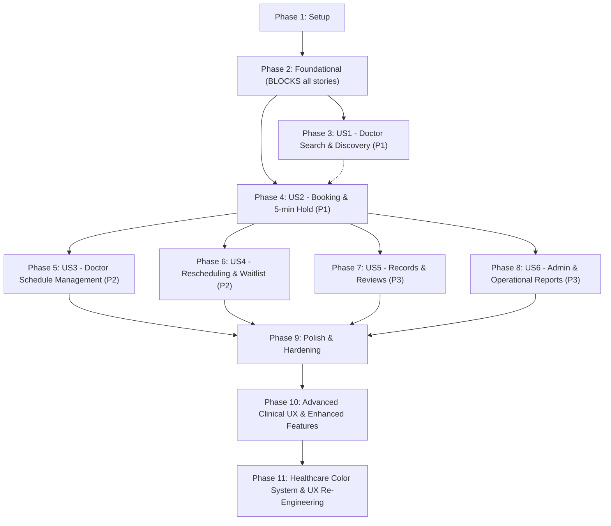

# Tasks: Doctor Appointment Booking System

**Input**: Design documents from `/specs/001-doctor-appointment-booking/`  
**Prerequisites**: [plan.md](file:///c:/Users/Pathi/Documents/specdriven_sepecit/Specdriven_using_specit/specs/001-doctor-appointment-booking/plan.md), [spec.md](file:///c:/Users/Pathi/Documents/specdriven_sepecit/Specdriven_using_specit/specs/001-doctor-appointment-booking/spec.md), [data-model.md](file:///c:/Users/Pathi/Documents/specdriven_sepecit/Specdriven_using_specit/specs/001-doctor-appointment-booking/data-model.md), [contracts/api-spec.yaml](file:///c:/Users/Pathi/Documents/specdriven_sepecit/Specdriven_using_specit/specs/001-doctor-appointment-booking/contracts/api-spec.yaml), [research.md](file:///c:/Users/Pathi/Documents/specdriven_sepecit/Specdriven_using_specit/specs/001-doctor-appointment-booking/research.md), [quickstart.md](file:///c:/Users/Pathi/Documents/specdriven_sepecit/Specdriven_using_specit/specs/001-doctor-appointment-booking/quickstart.md)

**Organization**: Tasks are grouped by user story to enable independent implementation and testing of each story.

## Format: `- [ ] [ID] [P?] [Story?] Description with file path`

- **[P]**: Can run in parallel (different files, no dependencies on incomplete tasks)
- **[Story]**: Which user story this task belongs to (e.g., `[US1]`, `[US2]`, `[US3]`, `[US4]`, `[US5]`, `[US6]`)
- Every task specifies an exact file path and concrete action

---

## Phase 1: Setup (Shared Infrastructure)

**Purpose**: Project initialization, workspace structure, and shared configuration for backend and frontend.

- [X] T001 Initialize root monorepo scripts and directory structure in package.json
- [X] T002 [P] Initialize Node.js backend workspace with TypeScript, Express, Zod, and better-sqlite3 in backend/package.json and backend/tsconfig.json
- [X] T003 [P] Initialize React frontend workspace with Vite, TypeScript, Tailwind CSS, Lucide React, and TanStack Query in frontend/package.json and frontend/vite.config.ts
- [X] T004 [P] Configure shared linting, formatting, and path aliases in backend/tsconfig.json and frontend/tsconfig.json

---

## Phase 2: Foundational (Blocking Prerequisites)

**Purpose**: Core infrastructure that MUST be complete before ANY user story can be implemented.

**⚠️ CRITICAL**: No user story work can begin until this phase is complete.

- [X] T005 Setup SQLite database connection, transaction manager, and migration harness in backend/src/models/db.ts
- [X] T006 [P] Define core relational database schema DDL with constraints in backend/src/models/schema.sql (including `users.role CHECK in ('PATIENT', 'DOCTOR', 'ADMIN', 'RECEPTIONIST')`, `users.status CHECK in ('ACTIVE', 'SUSPENDED', 'INACTIVE')`, and `audit_logs` table)
- [X] T007 [P] Implement centralized error handling middleware and HTTP error classes in backend/src/middlewares/error.middleware.ts
- [X] T008 [P] Implement immutable audit logging service and middleware in backend/src/services/audit.service.ts and backend/src/middlewares/audit.middleware.ts
- [X] T009 Implement user authentication, credential validation, and password/OTP hashing service in backend/src/services/auth.service.ts
- [X] T010 [P] Implement JWT token verification and Role-Based Access Control (RBAC) middleware in backend/src/middlewares/auth.middleware.ts and backend/src/middlewares/rbac.middleware.ts
- [X] T011 Implement auth controllers and route registration for `/api/auth/register`, `/api/auth/login`, `/api/auth/otp/send`, `/api/auth/otp/verify`, and `/api/auth/me` in backend/src/controllers/auth.controller.ts and backend/src/routes/auth.routes.ts
- [X] T012 [P] Setup frontend API client with Axios and Bearer auth token interceptors in frontend/src/services/api.ts
- [X] T013 [P] Implement frontend Auth Context, persistent token storage, and ProtectedRoute wrapper in frontend/src/context/AuthContext.tsx and frontend/src/components/common/ProtectedRoute.tsx
- [X] T014 [P] Implement responsive shell layout with Navbar, Sidebar, and active RoleSwitcher in frontend/src/components/layout/Navbar.tsx and frontend/src/components/layout/ShellLayout.tsx
- [X] T015 Create database seed script with mock doctors, clinic locations, and test user credentials in backend/src/scripts/seed.ts

**Checkpoint**: Foundation ready — user story implementation can now begin independently.

---

## Phase 3: User Story 1 - Doctor Search and Discovery (Priority: P1) 🎯 MVP

**Goal**: Patients can search and filter doctors by specialization, location/city, fee range, language, and slot availability, and view doctor profiles with ratings and open slots.

**Independent Test**: Navigate to search directory, apply multi-criteria filters, and view doctor profile details and available calendar slots without requiring account login or booking.

- [X] T016 [P] [US1] Create DoctorProfile entity types and Zod schemas in backend/src/models/doctor.model.ts with fields: `specialization` NOT NULL, `qualifications` NOT NULL, `experience_years` INTEGER DEFAULT 0, `languages` TEXT NOT NULL (JSON string array), `clinic_name` NOT NULL, `clinic_address` NOT NULL, `city` NOT NULL, `in_person_fee` DECIMAL(10,2) NOT NULL, `video_fee` DECIMAL(10,2) NOT NULL, `rating_avg` DECIMAL(3,2) DEFAULT 0.00, and `rating_count` INTEGER DEFAULT 0
- [X] T017 [P] [US1] Implement DoctorService search and filter database queries supporting `query`, `specialization`, `city`, `maxFee`, `language`, and `date` in backend/src/services/doctor.service.ts
- [X] T018 [US1] Implement DoctorController and router for `GET /api/doctors`, `GET /api/doctors/:id`, and `GET /api/doctors/:id/slots` in backend/src/controllers/doctor.controller.ts and backend/src/routes/doctor.routes.ts
- [X] T019 [P] [US1] Create frontend DoctorCard and FilterSidebar components in frontend/src/components/search/DoctorCard.tsx and frontend/src/components/search/FilterSidebar.tsx
- [X] T020 [P] [US1] Create frontend DoctorSearchPage with instant multi-facet filter bar and result grid in frontend/src/pages/patient/DoctorSearchPage.tsx
- [X] T021 [US1] Create frontend DoctorProfilePage displaying qualifications, clinic details, ratings, and weekly available slot calendar in frontend/src/pages/patient/DoctorProfilePage.tsx

**Checkpoint**: At this point, User Story 1 is fully functional and delivers standalone discovery value.

---

## Phase 4: User Story 2 - Patient Appointment Booking & Temporary Slot Hold (Priority: P1) 🎯 MVP

**Goal**: Patients select an available slot (in-person or video), acquire an atomic 5-minute hold lock preventing double-booking, complete checkout, and receive instant confirmation with video consultation room access.

**Independent Test**: Select a slot in Window A, verify the 5-minute hold lock prevents Window B from booking the same slot (HTTP 409 Conflict), complete payment, and confirm slot transitions to `BOOKED`.

- [X] T022 [P] [US2] Create AppointmentSlot and Appointment entity types and Zod schemas in backend/src/models/appointment.model.ts with `status CHECK in ('AVAILABLE', 'HELD', 'BOOKED', 'BLOCKED')`, `consultation_type CHECK in ('IN_PERSON', 'VIDEO')`, `status CHECK in ('CONFIRMED', 'IN_PROGRESS', 'COMPLETED', 'CANCELLED', 'NO_SHOW')`, and `payment_status CHECK in ('PAID', 'PENDING', 'AT_CLINIC', 'REFUNDED')`
- [X] T023 [US2] Implement atomic SlotLockService in backend/src/services/slot-lock.service.ts executing conditional atomic SQL `UPDATE appointment_slots SET status = 'HELD', hold_expires_at = datetime('now', '+5 minutes'), held_by_user_id = :userId WHERE id = :slotId AND status = 'AVAILABLE'` returning 409 Conflict when 0 rows affected
- [X] T024 [P] [US2] Implement Hold TTL Background Sweeper worker in backend/src/workers/hold-sweeper.ts running every 10 seconds to reset expired held slots (`status = 'HELD' AND hold_expires_at < datetime('now')`) back to `AVAILABLE`
- [X] T025 [US2] Implement AppointmentService booking confirmation, unique alphanumeric `booking_reference` generator (`APT-YYYYMM-XXXX`), and WebRTC room ID token generation in backend/src/services/appointment.service.ts
- [X] T026 [US2] Implement SlotController and AppointmentController routes for `POST /api/slots/:id/hold`, `POST /api/slots/:id/release`, `POST /api/appointments`, and `GET /api/appointments/:id` in backend/src/controllers/slot.controller.ts, backend/src/controllers/appointment.controller.ts, and backend/src/routes/appointment.routes.ts
- [X] T027 [P] [US2] Create frontend live 5-minute HoldCountdownTimer component with visual warning on timeout in frontend/src/components/booking/HoldCountdownTimer.tsx
- [X] T028 [P] [US2] Create frontend BookingModal and CheckoutStepper component (mode selection, patient details, payment simulation) in frontend/src/components/booking/BookingStepper.tsx
- [X] T029 [US2] Create frontend BookingConfirmationPage and TelehealthRoomPage embedding WebRTC video interface in frontend/src/pages/patient/BookingConfirmationPage.tsx and frontend/src/pages/patient/TelehealthRoomPage.tsx

**Checkpoint**: Core booking engine complete with 100% collision prevention and live hold timer. User Stories 1 AND 2 deliver a viable commercial MVP!

---

## Phase 5: User Story 3 - Doctor Schedule & Availability Management (Priority: P2)

**Goal**: Doctors configure weekly recurring shifts, slot durations (15/30/45/60m), break intervals, declare leaves, and trigger emergency schedule blocks with patient alert notifications.

**Independent Test**: Doctor logs in, updates working hours and blocks tomorrow afternoon; verify public calendar immediately updates available inventory.

- [X] T030 [P] [US3] Create DoctorSchedule and ScheduleBlock entity types and Zod schemas in backend/src/models/schedule.model.ts with `day_of_week CHECK between 0 and 6`, `slot_duration_minutes CHECK in (15, 30, 45, 60)`, and `is_emergency BOOLEAN DEFAULT FALSE`
- [X] T031 [US3] Implement ScheduleService in backend/src/services/schedule.service.ts for generating bookable slots from weekly shift parameters and applying leave blocks that detect affected confirmed appointments
- [X] T032 [US3] Implement ScheduleController routes for `GET /api/schedules/recurring`, `PUT /api/schedules/recurring`, and `POST /api/schedules/blocks` in backend/src/controllers/schedule.controller.ts and backend/src/routes/schedule.routes.ts
- [X] T033 [P] [US3] Create frontend DoctorScheduleBuilder and ShiftConfigForm components in frontend/src/components/doctor/ScheduleBuilder.tsx
- [X] T034 [P] [US3] Create frontend EmergencyBlockModal with patient impact warnings in frontend/src/components/doctor/EmergencyBlockModal.tsx
- [X] T035 [US3] Create frontend DoctorDashboardPage displaying upcoming daily consultation agenda, patient queue, and schedule manager in frontend/src/pages/doctor/DoctorDashboardPage.tsx

**Checkpoint**: Doctors have autonomous control over their calendar, working hours, and emergency blocks.

---

## Phase 6: User Story 4 - Appointment Rescheduling, Cancellation & Waitlist (Priority: P2)

**Goal**: Patients reschedule or cancel appointments up to 2 hours before the slot; cancellations automatically notify FIFO waitlisted patients to claim the freed slot.

**Independent Test**: Patient cancels confirmed booking >2h ahead; verify slot is freed and next waitlisted patient receives notification with priority booking link.

- [X] T036 [P] [US4] Create WaitlistEntry entity types and Zod schemas in backend/src/models/waitlist.model.ts with `status CHECK in ('ACTIVE', 'NOTIFIED', 'CLAIMED', 'EXPIRED')`
- [X] T037 [US4] Implement 2-hour cancellation cut-off policy check, fee penalty flag, and slot release logic in backend/src/services/appointment.service.ts
- [X] T038 [US4] Implement WaitlistService with FIFO queue query, `OnAppointmentCancelled` domain event listener, and 15-minute priority claim window in backend/src/services/waitlist.service.ts
- [X] T039 [US4] Implement WaitlistController and appointment lifecycle routes for `POST /api/waitlist`, `POST /api/appointments/:id/reschedule`, and `POST /api/appointments/:id/cancel` in backend/src/controllers/waitlist.controller.ts and backend/src/routes/waitlist.routes.ts
- [X] T040 [P] [US4] Create frontend WaitlistModal component allowing patients to join waitlists on fully booked dates in frontend/src/components/booking/WaitlistModal.tsx
- [X] T041 [US4] Create frontend PatientMyAppointmentsPage with tabbed appointment statuses, one-click reschedule modal, and cancellation flow in frontend/src/pages/patient/PatientMyAppointmentsPage.tsx

**Checkpoint**: Full appointment lifecycle management with automated cancellation recapture via waitlists.

---

## Phase 7: User Story 5 - Medical Records, Prescriptions & Post-Visit Reviews (Priority: P3)

**Goal**: Patients and doctors upload/view diagnostic reports and digital prescriptions; patients submit 1 to 5-star ratings and written reviews for completed consultations.

**Independent Test**: Upload lab PDF to an appointment; doctor completes visit and issues prescription; patient submits 5-star review that updates doctor's public rating score.

- [X] T042 [P] [US5] Create MedicalRecord and Review entity types and Zod schemas in backend/src/models/record.model.ts and backend/src/models/review.model.ts with `record_type CHECK in ('PRESCRIPTION', 'LAB_REPORT', 'DIAGNOSTIC_IMAGE', 'VISIT_SUMMARY', 'OTHER')` and `rating CHECK between 1 and 5`
- [X] T043 [P] [US5] Implement secure multipart file upload with Multer and temporary 10-minute signed URL generator in backend/src/services/record.service.ts
- [X] T044 [US5] Implement ReviewService with doctor aggregate calculation (`rating_avg = SUM(rating)/COUNT(*)` and `rating_count`) in backend/src/services/review.service.ts
- [X] T045 [US5] Implement RecordController and ReviewController routes for `POST /api/appointments/:id/records`, `GET /api/appointments/:id/records`, `POST /api/appointments/:id/complete`, and `POST /api/appointments/:id/review` in backend/src/controllers/record.controller.ts and backend/src/controllers/review.controller.ts
- [X] T046 [P] [US5] Create frontend MedicalRecordUploader and PrescriptionViewer components in frontend/src/components/consultation/MedicalRecordUploader.tsx and frontend/src/components/consultation/PrescriptionViewer.tsx
- [X] T047 [P] [US5] Create frontend ReviewFormModal component with interactive star rating selector and comment input in frontend/src/components/consultation/ReviewFormModal.tsx
- [X] T048 [US5] Create frontend PatientMedicalRecordsPage and DoctorConsultationNotesPage in frontend/src/pages/patient/PatientMedicalRecordsPage.tsx and frontend/src/pages/doctor/DoctorConsultationNotesPage.tsx

**Checkpoint**: Complete clinical documentation and patient trust feedback loop established.

---

## Phase 8: User Story 6 - Clinic Administration, Front-Desk Operations & Operational Reporting (Priority: P3)

**Goal**: Clinic receptionists book walk-ins and manage clinic payments; clinic administrators inspect operational reports on booking volume, revenue, no-show rates, and doctor utilization.

**Independent Test**: Receptionist creates appointment for walk-in patient; administrator views operational reporting dashboard displaying real-time metrics.

- [X] T049 [P] [US6] Implement ReportService computing aggregated operational metrics (total bookings, completed visits, cancellation percentage, no-show rate, revenue breakdown, doctor utilization percentage) in backend/src/services/report.service.ts
- [X] T050 [US6] Implement AdminController routes for `GET /api/admin/reports/operational` and walk-in appointment creation with `'AT_CLINIC'` payment status in backend/src/controllers/admin.controller.ts and backend/src/routes/admin.routes.ts
- [X] T051 [P] [US6] Create frontend ReceptionistWalkInBookingModal supporting fast phone/name slot reservation in frontend/src/components/admin/ReceptionistWalkInBookingModal.tsx
- [X] T052 [P] [US6] Create frontend MetricsSummaryCard and UtilizationChart components using Lucide icons in frontend/src/components/reports/MetricsSummaryCard.tsx and frontend/src/components/reports/UtilizationChart.tsx
- [X] T053 [US6] Create frontend AdminDashboardPage with interactive operational reports, date range picker, and receptionist quick-actions in frontend/src/pages/admin/AdminDashboardPage.tsx

**Checkpoint**: Multi-role clinic operations and management analytics fully operational.

---

## Phase 9: Polish & Cross-Cutting Concerns

**Purpose**: System hardening, multi-client race-condition verification, audit compliance check, and quickstart scenario validation.

- [X] T054 [P] Implement multi-client concurrency simulation test firing 50 simultaneous booking requests for the same slot verifying exactly 1 succeeds and 49 receive 409 Conflict in backend/tests/concurrency/slot-lock.test.ts
- [X] T055 [P] Implement API integration tests verifying Role-Based Access Control (RBAC) boundaries across all endpoints in backend/tests/integration/rbac.test.ts
- [X] T056 [P] Implement frontend component and journey tests for doctor search, hold countdown timer, and booking checkout in frontend/src/tests/booking-flow.test.tsx
- [X] T057 Optimize frontend bundle size with Vite chunk splitting, React lazy-loaded routes, and toast notification alerts in frontend/src/App.tsx
- [X] T058 Execute end-to-end validation covering all 8 validation scenarios defined in specs/001-doctor-appointment-booking/quickstart.md

---

## Phase 10: Advanced Clinical UX & Enhanced Features (User Stories 7–10)

**Purpose**: Deliver eye-appealing clinical UI, symptom-guided search, side-by-side comparison drawer, time-of-day slot segmentation, digital prescription letterhead generator, patient health timeline, live queue board, and in-call clinical vitals HUD.

- [X] T059 [P] [US7] Create interactive Symptom-to-Specialization navigator with symptom badges in frontend/src/components/search/SymptomNavigator.tsx
- [X] T060 [P] [US7] Create side-by-side Doctor Comparison Drawer & Modal comparing up to 3 doctors in frontend/src/components/search/DoctorComparisonDrawer.tsx
- [X] T061 [US7] Update DoctorCard and DoctorSearchPage with comparison selector, symptom filtering, and time-of-day (Morning/Afternoon/Evening) slot segmentation in frontend/src/components/search/DoctorCard.tsx and frontend/src/pages/patient/DoctorSearchPage.tsx
- [X] T062 [P] [US8] Create print-ready Digital Prescription Modal with clinic letterhead, Rx watermark, medicine dosage schedule table, and PDF/print action in frontend/src/components/consultation/DigitalPrescriptionModal.tsx
- [X] T063 [P] [US8] Create interactive chronological Patient Health Timeline organizing visits, prescriptions, and lab tests in frontend/src/pages/patient/PatientHealthTimelinePage.tsx
- [X] T064 [P] [US9] Create Live Reception Queue Display Board with real-time tokens, waiting room status, and estimated wait times in frontend/src/pages/admin/LiveQueueBoardPage.tsx
- [X] T065 [P] [US10] Create in-call Clinical Vitals HUD and live clinical note-taking scratchpad in frontend/src/components/consultation/ClinicalVitalsHud.tsx and integrate into frontend/src/pages/patient/TelehealthRoomPage.tsx
- [X] T066 [P] [US2] Implement one-click calendar export (.ics file download and Google/Outlook calendar URLs) in frontend/src/pages/patient/BookingConfirmationPage.tsx and frontend/src/pages/patient/PatientMyAppointmentsPage.tsx
- [X] T067 Update Navbar navigation links, quick shortcuts, and App.tsx routes for new views in frontend/src/components/layout/Navbar.tsx and frontend/src/App.tsx
- [X] T068 Verify frontend build and styling with Vite production bundle execution

---

## Phase 11: Healthcare Color System & Clinical UX Re-Engineering (User Stories 11 & 12)

**Purpose**: Transition the React frontend to a calming clinical healthcare color system (Medical Trust Blue, Serene Cyan/Teal, Crisp Porcelain Canvas, Deep Slate Typography, WCAG AA compliance) and re-engineer user journeys into streamlined, frictionless flows.

- [X] T069 [P] [US11] Configure unified Healthcare Color Palette and typography tokens in frontend/tailwind.config.js and frontend/src/index.css (Medical Trust Blue `#2563eb`, Serene Ocean Cyan `#0284c7`, Clinical Mint/Teal `#0d9488`, Crisp Porcelain Canvas `#f8fafc`, Soft Warm Slate borders `#e2e8f0`, Deep Slate Typography `#0f172a`)
- [X] T070 [P] [US11] Re-skin ShellLayout and Navbar with airy medical porcelain styling, subtle card borders, and accessible high-contrast navigation in frontend/src/components/layout/ShellLayout.tsx and frontend/src/components/layout/Navbar.tsx
- [X] T071 [US11] Re-skin DoctorSearchPage, FilterSidebar, and SymptomNavigator to replace heavy dark blocks with crisp clinical card elevation, active count badges, and clear visual hierarchy in frontend/src/pages/patient/DoctorSearchPage.tsx, frontend/src/components/search/FilterSidebar.tsx, and frontend/src/components/search/SymptomNavigator.tsx
- [X] T072 [P] [US11] Re-skin DoctorCard and DoctorComparisonDrawer with trust seals, hospital affiliations, clean slot pill segment badges, and accessible WCAG AA contrast in frontend/src/components/search/DoctorCard.tsx and frontend/src/components/search/DoctorComparisonDrawer.tsx
- [X] T073 [US12] Re-engineer BookingStepper and BookingConfirmationPage with a refined 3-step animated checkout flow, prominent 5-minute countdown pill, and accessible review summary in frontend/src/components/booking/BookingStepper.tsx and frontend/src/pages/patient/BookingConfirmationPage.tsx
- [X] T074 [P] [US12] Re-skin PatientHealthTimelinePage and DigitalPrescriptionModal with clean medical porcelain styling, luminous status nodes, and authentic letterhead typography in frontend/src/pages/patient/PatientHealthTimelinePage.tsx and frontend/src/components/consultation/DigitalPrescriptionModal.tsx
- [X] T075 [P] [US12] Re-skin LiveQueueBoardPage for optimal physical waiting room signage visibility, featuring high-contrast token numbers, prominent cabin highlights, and audio chime indicators in frontend/src/pages/admin/LiveQueueBoardPage.tsx
- [X] T076 [P] [US12] Re-skin TelehealthRoomPage and ClinicalVitalsHud with distraction-free video feeds, clean vitals cards, and high-visibility crimson allergy alert tags in frontend/src/pages/patient/TelehealthRoomPage.tsx and frontend/src/components/consultation/ClinicalVitalsHud.tsx
- [X] T077 [US11] Execute WCAG 2.1 AA color contrast validation and frontend bundle build verification via npm --prefix frontend run build

---

## Dependencies & Execution Order

### Phase Dependencies



### User Story Dependencies

- **User Story 1 (P1)**: Depends only on Foundational Phase (Phase 2). Can be deployed as a read-only doctor discovery directory.
- **User Story 2 (P1)**: Depends on Foundational Phase (Phase 2) and consumes Doctor entities from US1. Completes the core MVP booking engine.
- **User Story 3 (P2)**: Extends slot generation and allows doctors to customize their availability.
- **User Story 4 (P2)**: Extends appointments with cancellation policies and FIFO waitlist notifications.
- **User Story 5 (P3)**: Attaches medical records and post-visit ratings to completed appointments.
- **User Story 6 (P3)**: Aggregates system-wide data across appointments and schedules for clinic administrators and receptionists.

---

## Parallel Execution Opportunities

### User Story 1 (Search & Discovery) Parallel Batch
```bash
# Backend schema & search query:
Task T016: "Create DoctorProfile entity types and Zod schemas in backend/src/models/doctor.model.ts"
Task T017: "Implement DoctorService search and filter database queries in backend/src/services/doctor.service.ts"

# Frontend presentation components:
Task T019: "Create frontend DoctorCard and FilterSidebar components in frontend/src/components/search/DoctorCard.tsx"
Task T020: "Create frontend DoctorSearchPage in frontend/src/pages/patient/DoctorSearchPage.tsx"
```

### User Story 2 (Booking & Slot Hold) Parallel Batch
```bash
# Concurrency sweeper & entity schemas:
Task T022: "Create AppointmentSlot and Appointment entity types in backend/src/models/appointment.model.ts"
Task T024: "Implement Hold TTL Background Sweeper worker in backend/src/workers/hold-sweeper.ts"

# Frontend components:
Task T027: "Create frontend live 5-minute HoldCountdownTimer in frontend/src/components/booking/HoldCountdownTimer.tsx"
Task T028: "Create frontend BookingModal and CheckoutStepper in frontend/src/components/booking/BookingStepper.tsx"
```

---

## Implementation Strategy

### 1. MVP Scope (Phases 1, 2, 3 & 4)
- Delivers the essential value: patients find doctors, inspect their profiles, lock open slots for 5 minutes, and confirm appointments with zero double-booking.
- Provides immediate testable and demonstrable software.

### 2. Incremental Feature Slices
- **Increment 2 (Doctor Autonomy)**: Phase 5 introduces the Doctor Schedule Builder and emergency leaves.
- **Increment 3 (Retention & Flexibility)**: Phase 6 delivers cancellation cut-off policies and automated waitlists.
- **Increment 4 (Consultation Quality)**: Phase 7 enables medical document attachments and verified doctor reviews.
- **Increment 5 (Clinic Operations)**: Phase 8 provides receptionist walk-in booking and admin analytics.
- **Increment 6 (Hardening)**: Phase 9 stress-tests concurrency and verifies the quickstart guide.
- **Increment 7 (Advanced Clinical Features)**: Phase 10 introduces symptom navigator, comparison drawer, digital prescription letterhead, health timeline, and live queue board.
- **Increment 8 (Healthcare Design System & UX Re-Engineering)**: Phase 11 transitions the frontend to an accessible, calming clinical palette (Medical Trust Blue, Serene Cyan/Teal, Crisp Porcelain) and streamlines multi-step patient flows for WCAG 2.1 AA compliance.

